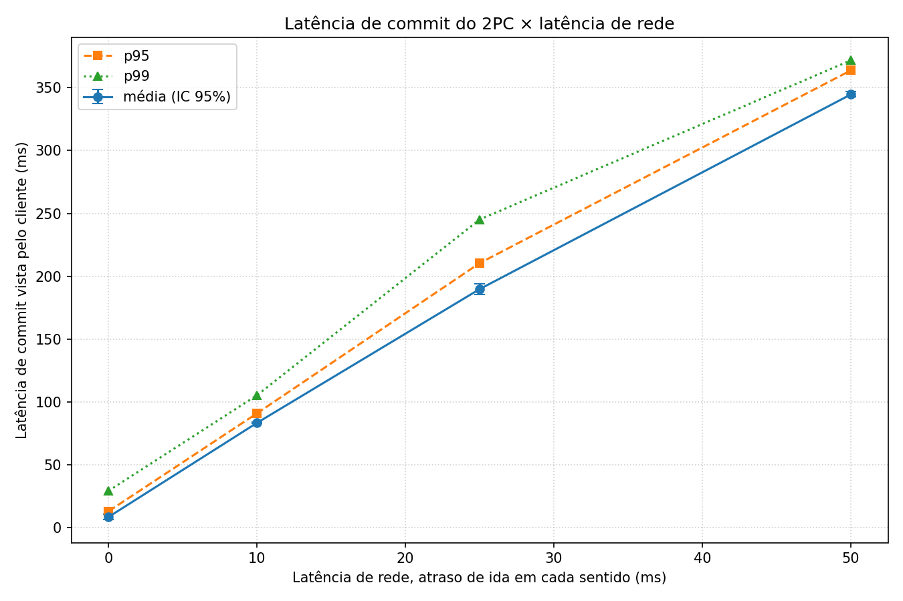

# Resultados: Two-Phase Commit

A bateria mede o 2PC nos Nós reais. Cada Réplica sobe o compose do zero, com o Toxiproxy entre o
Coordenador e cada Participante, aplica a latência do nível e derruba tudo no fim. A análise lê os
CSVs de `results/` sem reexecutar Réplica, e `python scripts/analisar.py conferir` reprova se alguma
tabela abaixo ficar defasada. Os tempos são de relógio, valem para a máquina carimbada em cada linha
dos CSVs e mudam um pouco a cada execução da bateria.

## Configuração

- **Topologia.** Um Coordenador e três Participantes, todos votando SIM.
- **Latência de rede.** Atraso de ida de 0, 10, 25 e 50 ms, sem jitter, aplicado pelo Toxiproxy nos
  dois sentidos de cada um dos quatro proxies. Um envio do Transporte custa então dois atrasos de ida,
  mais o processamento.
- **Réplicas.** Cinco por nível. As Sementes vão de 42 a 61 na latência e de 62 a 81 na
  recuperação. A Semente entra nos ids de transação e no log de cada Nó, mas o tempo medido não
  depende dela.
- **Transações.** 45 por Réplica, em sequência. As 5 primeiras são aquecimento: ficam no CSV,
  marcadas, e as tabelas as descartam. Cada transação só começa depois de o Coordenador receber todos
  os ACK da anterior, para não herdar a fila de saída dela.
- **Prazos do compose.** 3 s para a coleta de Votos, 2 s por envio e retransmissão da DECISAO a cada
  1 s.
- **Duração e ambiente.** Cada linha traz a duração das transações da Réplica (`duracao_replica_s`) e
  o ambiente (`amb_*`), inclusive as versões do Docker e do Compose e o Python da imagem.

```bash
python scripts/bateria.py --algoritmo 2pc     # cerca de 10 min nesta máquina
python scripts/analisar.py 2pc-latencia
python scripts/analisar.py 2pc-recuperacao
```

## Latência de commit × latência de rede

A latência é a do `POST /transacao` vista pelo cliente. O Coordenador responde quando a Decisao já
está no Log_Duravel dele. Média e IC 95% saem das médias por Réplica, que são as amostras
independentes, e os percentis saem de todas as transações do nível. Mensagens é a média, por
transação, dos eventos `envia` nos logs de todos os Nós.

| Latência de rede (ms) | Réplicas | Transações | Média (ms) | IC 95% (±) | p50 (ms) | p95 (ms) | p99 (ms) | Mensagens |
|:----------------------|---------:|-----------:|-----------:|-----------:|---------:|---------:|---------:|----------:|
| 0                     |        5 |        200 |        8,5 |        2,1 |      7,1 |     13,0 |     29,3 |     12,00 |
| 10                    |        5 |        200 |       83,3 |        0,5 |     83,7 |     90,9 |    105,3 |     12,00 |
| 25                    |        5 |        200 |      189,8 |        4,4 |    189,1 |    210,4 |    245,1 |     12,00 |
| 50                    |        5 |        200 |      344,6 |        2,1 |    345,0 |    363,7 |    371,7 |     12,00 |

> Tabela gerada por `python scripts/analisar.py 2pc-latencia` a partir de `results/bateria_2pc_latencia_rede.csv`. Não editar à mão: cole novamente a saída do comando.



A latência cresce em linha com o atraso de ida, e o número de mensagens não muda com ele. Os PREPARE
saem um depois do outro, então o Voto do último Participante só chega depois de seis atrasos de ida.

## Tempo de recuperação × latência de rede

Em cada Réplica, o processo do Coordenador morre logo depois de gravar a Decisao, antes de difundi-la,
e os três Participantes ficam em dúvida. O condutor reinicia o contêiner e mede do
`docker compose start` até todos os Participantes reportarem a Decisao. O tempo inclui a partida do
contêiner e do processo, a releitura do Log_Duravel e a DECISAO pela rede. Com uma amostra por
Réplica, a tabela mostra mínimo e máximo, e não percentis.

| Latência de rede (ms) | Réplicas | Média (s) | IC 95% (±) | Mínimo (s) | Máximo (s) | Mensagens |
|:----------------------|---------:|----------:|-----------:|-----------:|-----------:|----------:|
| 0                     |        5 |     0,553 |      0,030 |      0,533 |      0,592 |     18,00 |
| 10                    |        5 |     0,787 |      0,349 |      0,590 |      1,262 |     18,00 |
| 25                    |        5 |     0,866 |      0,477 |      0,671 |      1,552 |     16,80 |
| 50                    |        5 |     0,817 |      0,048 |      0,789 |      0,884 |     14,00 |

> Tabela gerada por `python scripts/analisar.py 2pc-recuperacao` a partir de `results/bateria_2pc_recuperacao.csv`. Não editar à mão: cole novamente a saída do comando.


A maior parte do tempo, e quase toda a variação entre Réplicas, vem da partida do contêiner e do
interpretador. Nos logs, o trecho que vai da partida do processo até o último Participante decidir é
curto em todas as Réplicas, inclusive nas mais lentas. As mensagens passam de 12 porque o Coordenador
difunde a Decisao relida antes de o servidor HTTP dele aceitar conexões. Os ACK que chegam nessa janela
falham, e a retransmissão de 1 s repete a DECISAO e o ACK desses Participantes. Com mais atraso, menos
ACK chegam cedo demais.
