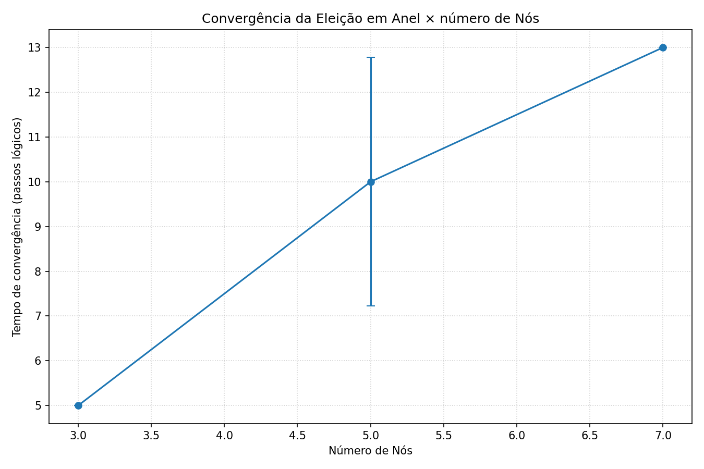

# Resultados: Eleição de Líder em Anel

A análise lê o CSV da bateria do Anel (`results/bateria_anel_num_nos.csv`) sem
reexecutar nenhuma Réplica nem subir contêiner. Nenhuma tabela
abaixo é digitada à mão: toda tabela é produto de um comando da análise,
e `python scripts/analisar.py conferir` reprova se alguma ficar
defasada em relação aos dados atuais.

## Configuração

- **Topologia.** Anel 1 → 2 → … → n → 1, com n de 3, 5 e 7 Nós, todos vivos, e o
  Nó 1 como único iniciador.
- **Perda.** Cada tentativa de entrega se perde com probabilidade 0,05, sorteada
  do stream `drop` da Semente, e o remetente reenvia até a entrega.
- **Réplicas.** Cinco por nível, com as Sementes de 42 a 56.
- **Duração.** A bateria roda em processo sobre a Máquina_de_Estados pura, e cada
  ensaio dura o tempo de convergência em passos lógicos, que está na tabela. Como
  a métrica é lógica, não há aquecimento a descartar.
- **Ambiente.** Carimbado em cada linha do CSV (`amb_*`). A bateria é
  determinística por Semente, e rodá-la de novo produz as mesmas métricas. Só as
  colunas `amb_*` mudam de uma máquina para outra.

```bash
python scripts/bateria.py --algoritmo anel     # em processo, menos de um segundo
python scripts/analisar.py anel
python scripts/analisar.py anel-complexidade
```

## Convergência × número de Nós

Para cada número de Nós, a tabela traz quantas Réplicas rodaram e quantas
convergiram, e a média e o IC 95% do Tempo_de_Convergencia das que convergiram,
em passos lógicos de entrega de Mensagem. O tempo é lógico, e não em segundos de
relógio, para ser reproduzível dígito a dígito entre máquinas, já que contêineres
numa só máquina não medem tempo portável (A6 do enunciado). Sem Nó morto, cada
passo é uma tentativa de entrega, e o tempo coincide com as mensagens da seção
seguinte.

| Nós | Réplicas | Convergiram | Tempo médio (passos) | IC 95% (±) |
|:----|---------:|------------:|---------------------:|-----------:|
| 3   |        5 |           5 |                 5,00 |       0,00 |
| 5   |        5 |           5 |                 9,20 |       0,56 |
| 7   |        5 |           5 |                13,40 |       0,68 |

> Tabela gerada por `python scripts/analisar.py anel` a partir de `results/bateria_anel_num_nos.csv`. Não editar à mão: cole novamente a saída do comando.



## Mensagens × complexidade esperada

Uma rodada completa com um só iniciador custa 2n mensagens. A eleição dá uma
volta de n mensagens até a lista de ids voltar ao iniciador, e o anúncio do Líder
dá outra volta de n mensagens até voltar a ele, que o encerra. A bateria para
quando o último Nó conhece o Líder, um salto antes de o anúncio voltar, e por
isso espera 2n − 1. Cada mensagem se perde com probabilidade p, e o remetente a
reenvia até ela chegar. Uma entrega custa então 1/(1 − p) tentativas em média, e
a bateria conta todas.

| Nós (n) | Perda (p) | Convergiram | Mensagens médias | IC 95% (±) | 2n − 1 | (2n − 1)/(1 − p) |
|:--------|----------:|------------:|-----------------:|-----------:|-------:|-----------------:|
| 3       |      0,05 |           5 |             5,00 |       0,00 |      5 |             5,26 |
| 5       |      0,05 |           5 |             9,20 |       0,56 |      9 |             9,47 |
| 7       |      0,05 |           5 |            13,40 |       0,68 |     13 |            13,68 |

> Tabela gerada por `python scripts/analisar.py anel-complexidade` a partir de `results/bateria_anel_num_nos.csv`. Não editar à mão: cole novamente a saída do comando.

As mensagens crescem linearmente com n, como prevê a conta. Com cinco Réplicas,
um nível pode passar sem nenhuma perda, como n = 3, e fica exatamente em 2n − 1.
Nos demais, o esperado com perda cai dentro do IC 95%. Com k iniciadores
simultâneos, cada um faz circular a própria eleição, e o custo sobe para até
k · 2n mensagens. A bateria mede o caso de um iniciador.
