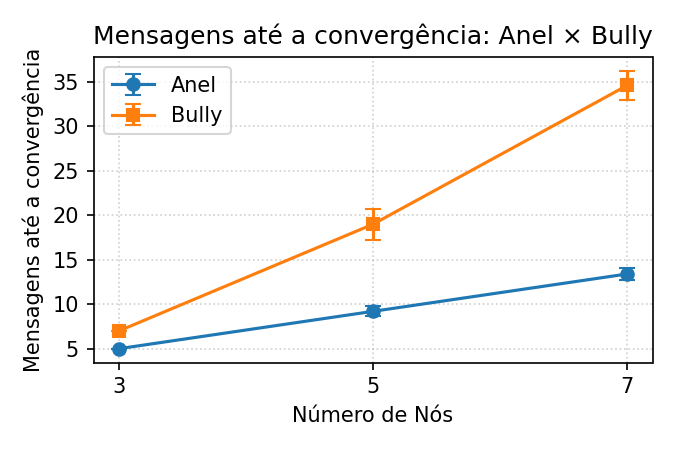

# Resultados: Eleição do valentão (Bully)

A análise lê o CSV da bateria do Bully (`results/bateria_bully_num_nos.csv`) e, na comparação,
também o do Anel (`results/bateria_anel_num_nos.csv`), sem reexecutar nenhuma Réplica nem subir
contêiner. Nenhuma tabela abaixo é digitada à mão: toda tabela é produto de um comando da análise,
e `python scripts/analisar.py conferir` reprova se alguma ficar defasada em relação aos dados atuais.

## Configuração

- **Topologia.** Todos com todos, com n de 3, 5 e 7 Nós, todos vivos, e o Nó 1 como único
  iniciador, que é o pior caso.
- **Variante.** A de `src/bully/maquina.py`. O OK leva o Líder em exercício, que responde a uma
  ELEICAO sem reabrir a eleição, e um COORDENADOR de id menor é rejeitado.
- **Perda.** A regra do Anel. Cada tentativa de entrega se perde com probabilidade 0,05, sorteada
  do stream `drop` da Semente, o remetente reenvia até a entrega e toda tentativa conta.
- **Prazos.** Um prazo só dispara com a fila de Mensagens vazia, o que modela o sistema síncrono.
  Com todos vivos, nenhum prazo chega a agir.
- **Réplicas.** Cinco por nível, com as Sementes de 42 a 56, as mesmas do Anel.
- **Duração.** A bateria roda em processo sobre a Máquina_de_Estados pura, e cada ensaio dura até
  não restar Mensagem nem prazo, contado em saltos lógicos. Como a métrica é lógica, não há
  aquecimento a descartar.
- **Ambiente.** Carimbado em cada linha do CSV (`amb_*`). A bateria é determinística por Semente, e
  rodá-la de novo produz as mesmas métricas. Só as colunas `amb_*` mudam de uma máquina para outra.

```bash
python scripts/bateria.py --algoritmo bully    # em processo, menos de um segundo
python scripts/analisar.py bully
python scripts/analisar.py bully-anel
```

## Mensagens × complexidade esperada

Com o Nó 1 como iniciador, cada Nó i convoca uma vez e manda uma ELEICAO a cada um dos n − i ids
acima dele, e cada ELEICAO recebe um OK. São n(n − 1)/2 ELEICAO e outros tantos OK, mais os n − 1
COORDENADOR do maior, ou n² − 1 Mensagens ao todo. O Líder em exercício responde às ELEICAO
atrasadas só com o OK, sem reabrir a eleição, e por isso o total é exato. O melhor caso, em que o
maior convoca, custa n − 1, e `tests/experimentos/test_runner_bully.py` o confere sem perda. Com
perda p, cada entrega custa em média 1/(1 − p) tentativas. A tabela conta até não restar Mensagem
em trânsito, o total que essas contas preveem.

| Nós (n) | Perda (p) | Convergiram | Mensagens médias | IC 95% (±) | n − 1 | n² − 1 | (n² − 1)/(1 − p) |
|:--------|----------:|------------:|-----------------:|-----------:|------:|-------:|-----------------:|
| 3       |      0,05 |           5 |             8,00 |       0,00 |     2 |      8 |             8,42 |
| 5       |      0,05 |           5 |            25,60 |       1,88 |     4 |     24 |            25,26 |
| 7       |      0,05 |           5 |            51,00 |       1,52 |     6 |     48 |            50,53 |

> Tabela gerada por `python scripts/analisar.py bully` a partir de `results/bateria_bully_num_nos.csv`. Não editar à mão: cole novamente a saída do comando.

O medido cresce com n², como prevê a conta. Em n = 3 nenhuma tentativa se perdeu, e o total fica
exatamente em n² − 1. Em n = 5 e n = 7, o esperado com perda cai dentro do IC 95%.

## Anel × Bully nas mesmas condições

As duas baterias usam os mesmos níveis, a mesma perda, as mesmas Sementes e o Nó 1 como iniciador,
e as duas param quando o último Nó aceita o maior id. `python scripts/analisar.py bully-anel`
recusa CSVs que difiram em nível, perda ou Sementes. O tempo é a profundidade causal em saltos de
Mensagem, e cada tentativa perdida soma um salto. No Anel com um iniciador há uma Mensagem em
trânsito por vez, então os passos da bateria do Anel são essa mesma profundidade. Cada célula traz a
média ± a meia-largura do IC 95%.

| Nós (n) | Perda (p) | Convergiram no Anel | Convergiram no Bully | Mensagens no Anel | Mensagens no Bully | Saltos no Anel | Saltos no Bully |
|:--------|----------:|--------------------:|---------------------:|------------------:|-------------------:|---------------:|----------------:|
| 3       |      0,05 |                   5 |                    5 |       5,00 ± 0,00 |        7,00 ± 0,00 |    5,00 ± 0,00 |     2,00 ± 0,00 |
| 5       |      0,05 |                   5 |                    5 |       9,20 ± 0,56 |       19,00 ± 1,76 |    9,20 ± 0,56 |     2,20 ± 0,56 |
| 7       |      0,05 |                   5 |                    5 |      13,40 ± 0,68 |       34,60 ± 1,67 |   13,40 ± 0,68 |     2,60 ± 0,68 |

> Tabela gerada por `python scripts/analisar.py bully-anel` a partir de `results/bateria_anel_num_nos.csv`, `results/bateria_bully_num_nos.csv`. Não editar à mão: cole novamente a saída do comando.



Em Mensagens, o Anel fica perto de 2n − 1 e o Bully cresce com n². Em saltos, a relação se
inverte. Sem perda, o Bully converge em 2 saltos para todo n, porque a ELEICAO do Nó 1 chega ao
maior num salto e o COORDENADOR dele chega a todos no seguinte. Cada tentativa perdida nesse
caminho soma um salto, e por isso a média passa um pouco de 2 em n = 5 e n = 7. O Anel precisa de
2n − 1, uma volta da eleição e quase uma volta do anúncio. O Bully paga Mensagens para convergir em
tempo que não cresce com n.
